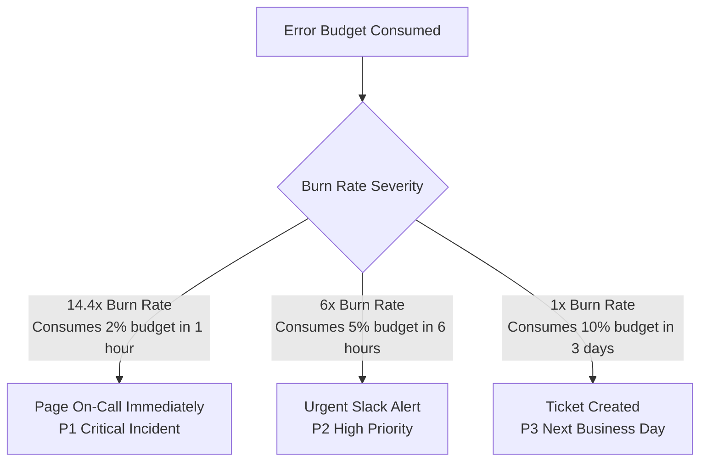

# Service Level Objective (SLO) & Error Budget Policy

**Project:** Robot Shop E-Commerce Platform  
**Target Services:** `web` (Frontend Gateway) & `payment` (Checkout Transaction Engine)  
**Standard:** Google Site Reliability Engineering (SRE) Framework  
**Version:** 1.0  
**Effective Date:** October 2026  

---

## 1. Executive Summary

This document establishes the official Service Level Indicators (SLIs), Service Level Objectives (SLOs), and Error Budget Policies for the core customer-facing services of the Stan's Robot Shop platform running on Amazon EKS.

The objective of this policy is to balance **product velocity** (shipping features and updates) with **operational reliability** (customer uptime and seamless checkout experience), providing quantitative data-driven triggers for on-call escalation and development freezes.

---

## 2. Services in Scope

| Service | Architecture Role | Business Criticality | Downstream Dependencies |
| :--- | :--- | :--- | :--- |
| **`web`** | User-facing NGINX reverse proxy & static frontend entry point | **Critical (Tier 1)** | `catalogue`, `cart`, `user`, `payment`, `ratings` |
| **`payment`** | Node.js / Express microservice authorizing orders and charging gateways | **Critical (Tier 1)** | `rabbitmq`, payment provider gateways |

---

## 3. Service Level Indicators (SLIs) & Objectives (SLOs)

### 3.1 Service: `web` (Frontend Ingress)

#### SLI 1: Availability
- **Definition:** The proportion of valid HTTP requests that return an HTTP status code other than `5xx` (Server Error), measured at the ingress layer.
- **Formula:**
  $$\text{SLI}_{\text{web\_avail}} = \frac{\sum \text{rate}(http\_requests\_total\{service="web", status! \sim "5.."\} [5m])}{\sum \text{rate}(http\_requests\_total\{service="web"\} [5m])}$$
- **SLO Target:** **99.0% availability** over a rolling 30-day window.

#### SLI 2: Latency
- **Definition:** The percentage of HTTP GET requests for static assets and catalog pages served in less than 500 milliseconds.
- **Formula:**
  $$\text{SLI}_{\text{web\_lat}} = \frac{\sum \text{rate}(http\_request\_duration\_seconds\_bucket\{service="web", le="0.5"\}[5m])}{\sum \text{rate}(http\_request\_duration\_seconds\_count\{service="web"\}[5m])}$$
- **SLO Target:** **95.0% of requests served within < 500ms** over a rolling 30-day window.

---

### 3.2 Service: `payment` (Transaction Engine)

#### SLI 1: Availability (Transaction Success Rate)
- **Definition:** The proportion of valid checkout charge attempts that successfully process and return HTTP `200 OK` (excluding client-side card validation errors `4xx`).
- **Formula:**
  $$\text{SLI}_{\text{payment\_avail}} = \frac{\sum \text{rate}(payment\_transactions\_total\{status="success"\}[5m])}{\sum \text{rate}(payment\_transactions\_total[5m])}$$
- **SLO Target:** **99.5% availability** over a rolling 30-day window.

#### SLI 2: Latency
- **Definition:** The percentage of payment authorization requests completed in under 1,000 milliseconds.
- **Formula:**
  $$\text{SLI}_{\text{payment\_lat}} = \frac{\sum \text{rate}(payment\_duration\_seconds\_bucket\{le="1.0"\}[5m])}{\sum \text{rate}(payment\_duration\_seconds\_count[5m])}$$
- **SLO Target:** **99.0% of requests served within < 1000ms** over a rolling 30-day window.

---

## 4. Error Budget Calculations

A 30-day calendar month consists of $30 \times 24 \times 60 = 43,200$ minutes.

| Service | Target SLO | Error Budget (%) | Allowed Downtime / Impairment (30 Days) |
| :--- | :--- | :--- | :--- |
| **`web`** | **99.0%** | **1.0%** | **432 minutes (7.2 hours)** |
| **`payment`** | **99.5%** | **0.5%** | **216 minutes (3.6 hours)** |

---

## 5. Burn Rate Alerting Tiers

To prevent alert fatigue while catching catastrophic outages immediately, Robot Shop uses multi-window multi-burn-rate alerting:

1. **Tier 1 (Catastrophic Burn - Page On-Call):**
   - **Condition:** 14.4x burn rate (2% error budget consumed within 1 hour).
   - **Notification:** PagerDuty / On-call rotation.
   - **Prometheus Rule:** `RobotShopPaymentAvailabilitySLOBreached` or `RobotShopWebAvailabilitySLOBreached`.

2. **Tier 2 (Elevated Burn - Urgent Investigation):**
   - **Condition:** 6.0x burn rate (5% error budget consumed within 6 hours).
   - **Notification:** Ops channel notification; investigation within 30 minutes.

3. **Tier 3 (Slow Burn - Maintenance Backlog):**
   - **Condition:** 1.0x burn rate (threatens monthly budget if sustained for 30 days).
   - **Notification:** Jira bug created for sprint prioritization.

---

## 6. Error Budget Policy & Enforcement

When error budgets are consumed, the engineering team adheres to the following contractual agreement:

| Remaining Budget | Policy State | Required Action |
| :--- | :--- | :--- |
| **> 50%** | **Healthy** | Normal feature releases, continuous delivery active. |
| **20% - 50%** | **Caution** | Increased code review scrutiny, canary deployment period doubled. |
| **0% - 20%** | **Degraded** | Non-critical deployments halted. Reliability and test automation tasks prioritized. |
| **≤ 0% (Exhausted)** | **Engineering Freeze** | **Full feature freeze enforced.** All product releases blocked. 100% engineering effort dedicated to stability, bug fixes, automated rollbacks, and infrastructure hardening until the rolling window recovers. |

---

## 7. Observability Stack Integration

The enforcement of this policy is monitored using our centralized observability suite:

- **Metrics:** Prometheus scrapes Kubernetes kube-state-metrics and container metrics every 30s.
- **Dashboards:** Grafana RED Metrics Dashboard (`monitoring/dashboards/robot-shop-red-metrics.json`) visualizes Rate, Errors, and Duration for all services.
- **Logs:** Loki & Fluent Bit aggregate and parse container logs into `{service="web"}` and `{service="payment"}` streams.
- **Traces:** OpenTelemetry Collector and Jaeger provide distributed span tracing across frontend, catalogue, cart, and payment.
